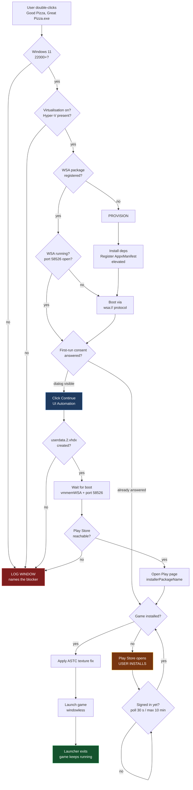
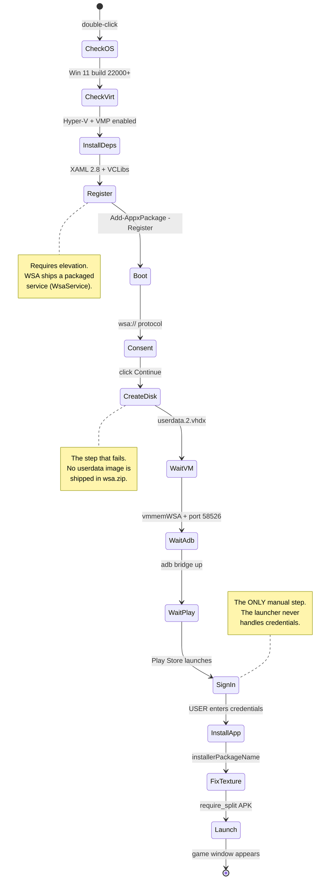

# Good Pizza, Great Pizza — one-click Windows launcher

[](https://github.com/yassine808/Good-pizza-great-pizza/releases/latest)
[](LICENSE)
[](https://github.com/yassine808/Good-pizza-great-pizza/releases/latest)

Run the Android game **Good Pizza, Great Pizza** (`com.tapblaze.pizzabusiness`) on
Windows 11 with a single double-click. The launcher owns the whole chain — Windows
subsystem check → WSA install → WSA boot → Google Play install → game launch — and
stays **completely silent** unless something goes wrong.

> **Status:** released. The [latest release](https://github.com/yassine808/Good-pizza-great-pizza/releases/latest)
> is a single ~300 KB exe that provisions a clean Windows 11 machine end to end. The WSA
> behaviour documented below is *reverse-engineered and verified on a real machine*
> (15 Oct 2026), including a clean-room run that started from an empty `C:\WSA`.

---

## Download

Take `Good.Pizza.Great.Pizza.exe` from the
[latest release](https://github.com/yassine808/Good-pizza-great-pizza/releases/latest),
double-click it, and approve the UAC prompt. That is the whole install — it carries no
installer, no runtime and no dependencies beyond stock Windows. The SHA-256 of each
asset is printed on its release page.

> **Antivirus.** The exe is not code-signed, and it downloads a subsystem, registers a
> package and elevates itself — precisely the shape AV heuristics look for. Avast was
> observed killing it within seconds in a freshly created folder while letting the same
> binary run from a folder it had already scanned. If your AV blocks it, allow it or
> add an exclusion for its folder.

---

## The one thing that matters

The whole project exists because of a single line in the Android side:

```
installerPackageName=com.android.vending
```

The game ships **PairIP** integrity protection. It kills any process whose install
record does not show the **Google Play Store** as the installer. Sideloading the APK —
via `adb install`, via a file manager, via any tool that does not go through Play —
produces an app that launches and immediately dies. There is no known bypass.

So the launcher never installs the game itself. It opens the Play Store page and lets
Play do the install, exactly as it would on a phone. Everything else in this project is
in service of getting Play Store up and running unattended.

---

## Screenshot


*The first-run consent dialog. WSA creates **no virtual machine** until this is answered.
It is why a "fresh install" silently does nothing. See
[The first-run gate](#the-first-run-gate).*

---

## Requirements

| Requirement | Why |
|---|---|
| Windows 11, build 22000+ | WSA does not exist on Windows 10 |
| Hardware virtualisation + Hyper-V | WSA is a real VM, not an emulator |
| ~2 GB free (WSA) + ~8 GB (Android userdata) | Boot images + dynamic userdata disk |
| Internet on first run | Downloads WSA + Play Store content |
| A Google account | Sign-in is **your** step — the launcher never touches credentials |

The launcher checks every one of these before touching anything, and names the first
one that fails.

---

## How it works



**Silent by default.** The launcher opens no main window. It only opens a log window
when a check fails — and that window names *which* check failed and what to do about
it. On success you never see it at all.

While it works, its only presence is a **tray icon** whose status line tracks the
current step: `downloading WSA - 334 of 713 MB - 11.1 MB/s`, `waiting for Google
sign-in - 3 min`, `playing - the launcher exits with the game`. Its menu offers the log
and an **Exit launcher** that cancels the run exactly like Ctrl+C.

**It leaves when the game does.** After submitting the `wsa://` activation the launcher
waits for the game window, then follows it and exits once it closes, so nothing of the
launcher stays resident behind the game.

**Downloads show their work.** The 713 MB WSA archive is the only transfer large enough
to deserve a window: a progress dialog with the byte count, the percentage, the
transfer rate and a rough ETA. Small tool downloads stay in the log.

---

## The provisioning cycle

First run on a clean machine goes through this loop. Every arrow is a state the
launcher verifies before moving on:



On run 2+ the cycle collapses: package registered → service running → game installed →
**launch, and exit**. The launcher does no work it does not need to do.

---

## WSA: what we verified

These are not guesses. Each was reproduced on Windows 11 build 26300 with the
**MagiskOnWSA** build of WSA `2407.40000.4.0` (LSPosed, AGPL, not stock Microsoft WSA).

### 1. Direct exe launch cannot work

`WsaClient.exe` lives alone in `C:\WSA\WsaClient\`. Its graphics backend,
`gfxstream_backend.dll`, sits in the **package root** `C:\WSA\` — not next to the exe,
not in `System32`.

```
C:\WSA\WsaClient\WsaClient.exe          <- the only file in this folder
C:\WSA\gfxstream_backend.dll            <- required, one level up
C:\WSA\amd64\msvcp140.dll               <- required, two levels up
```

A loader only finds those through the **package graph**, which is granted by *package
identity*. Running `Start-Process C:\WSA\WsaClient\WsaClient.exe` gives no identity, so
the loader reports the DLL as missing:

```
exit code 0xC0000135  STATUS_DLL_NOT_FOUND
```

**The fix:** never launch the exe. Use protocol activation, exactly as Microsoft's own
`Install.ps1` does — `Start-Process "wsa://com.android.vending"`. Windows resolves the
protocol to the package, grants identity, and the whole DLL graph resolves.

### 2. Registration requires elevation

```
Add-AppxPackage -Register C:\WSA\AppxManifest.xml
→ 0x80073D28  "Administrator privileges required to install packaged service."
```

WSA ships `WsaService.exe` as a **packaged service**. Unelevated registration fails. The
launcher therefore carries a `requireAdministrator` manifest — it elevates once, at
startup, before anything else happens.

### 3. The registration sequence

Taken from `C:\WSA\Install.ps1` (MagiskOnWSA), which is the authoritative order:

```powershell
# 1. unlock sideload for this machine
reg add HKLM\SOFTWARE\Microsoft\Windows\CurrentVersion\AppModelUnlock `
      /v AllowDevelopmentWithoutDevLicense /d 1

# 2. platform prerequisite
Enable-WindowsOptionalFeature -FeatureName VirtualMachinePlatform -Online

# 3. dependency packages, if below the manifest minimum
Add-AppxPackage -Path Microsoft.UI.Xaml.2.8_x64.appx
Add-AppxPackage -Path Microsoft.VCLibs.140.00.UWPDesktop_x64.appx
Add-AppxPackage -Path Microsoft.VCLibs.140.00_x64.appx

# 4. clean slate, then register the loose package
Get-AppxPackage *WindowsSubsystemForAndroid* | Remove-AppxPackage
WsaClient /shutdown
Add-AppxPackage -ForceApplicationShutdown -ForceUpdateFromAnyVersion `
      -Register C:\WSA\AppxManifest.xml

# 5. first boot
Start-Process "wsa://com.topjohnwu.magisk"
Start-Process "wsa://com.android.vending"
```

Measured dependency floor on this build:

| Package | Manifest minimum | Installed | OK |
|---|---|---|---|
| `Microsoft.UI.Xaml.2.8` | 8.2208.12001.0 | 8.2501.31001.0 | ✅ |
| `Microsoft.VCLibs.140.00.UWPDesktop` | 14.0.33728.0 | 14.0.33728.0 | ✅ |
| `Microsoft.VCLibs.140.00` | 14.0.33519.0 | 14.0.33519.0 | ✅ |

Installing a dependency that is already current fails with `0x80073D02` ("resources it
modifies are currently in use") because unrelated apps use those same framework
packages. The launcher **checks versions first** and only installs what is missing.

### 4. The first-run gate

After a fresh registration, the very first `wsa://` launch opens a **Win32 dialog**
(class `#32770`), titled *"Optional diagnostic data for Windows Subsystem for Android"*,
with two buttons: `Share my diagnostic data` and `Continue`.

Until `Continue` is pressed:

- no `vmwp` / `vmmemWSA` process appears
- no `userdata.2.vhdx` is created
- port 58526 never opens
- the launcher's boot wait times out and **nothing else can proceed**

This is the screenshot at the top of this file. The launcher finds the dialog by
`ProcessId` + class, then invokes the `Continue` button via **UI Automation** — no
screen coordinates, no mouse jiggle, so it survives different resolutions and DPI
scaling.

> **DPI note** (from capturing that screenshot): UI Automation reports *physical*
> pixels while a non-DPI-aware process gets *virtualised* coordinates from
> `Graphics.CopyFromScreen`. Call `SetProcessDPIAware()` before mixing the two.

### 5. The real blocker: `userdata.2.vhdx`

WSA's disk layout at boot:

| Image | Ships in `wsa.zip` | Size |
|---|---|---|
| `metadata.vhdx` | ✅ | 33 MB |
| `product.vhdx` | ✅ | 312 MB |
| `system.vhdx` | ✅ | 976 MB |
| `system_ext.vhdx` | ✅ | 176 MB |
| `vendor.vhdx` | ✅ | 272 MB |
| **`userdata.2.vhdx`** | **❌ not shipped** | **~5.7 GB, dynamic** |

The archive holds 312 entries and **none of them is a userdata image**. WSA must create
it at first boot. On this machine that step aborts, and it aborts identically every
single time — 12 crashes, all byte-for-byte the same signature:

```
Faulting application name: WsaClient.exe, version: 2407.40000.4.0
Faulting module name:     ucrtbase.dll, version: 10.0.26100.9711
Exception code:           0xc0000409
Fault offset:             0x00000000000a527e
Faulting module path:     C:\WINDOWS\System32\ucrtbase.dll
```

`0xc0000409` is `STATUS_STACK_BUFFER_OVERRUN` — here it is the CRT's **fail-fast path**
(`abort` / invalid-parameter handler), not a stack smash. The loaded-module list in the
WER report shows `d3d12`, `dxgi`, `d3d11` and `MFPlat` already resident, so WsaClient
gets all the way to the graphics stack before dying: it is *not* a missing-DLL problem.

The correlation is exact:

| State | `userdata.2.vhdx` | Result |
|---|---|---|
| Present (restored from backup) | ✅ | **Boots.** VM up, game window appears. |
| Missing (fresh registration) | ❌ | `0xc0000409` at the instant the VM would start. |
| Missing + consent unanswered | ❌ | Silent no-op, no crash — it never gets that far. |

A full crash dump is captured to `C:\WSAdumps\` via WER `LocalDumps` for further
analysis of exactly which CRT call fails.

> That analysis was overtaken by the clean-room result below: after a full teardown the
> same machine provisions and boots normally, so the abort follows *leftover* state
> rather than following a clean machine.

---

## Failure modes, in the order they bite

| Symptom | Exit / code | Cause | Fix in the launcher |
|---|---|---|---|
| Immediate exit, no window | `0xC0000135` | `WsaClient` launched directly → no package identity → DLL graph unresolved | Boot only via `wsa://` |
| Registration refuses | `0x80073D28` | Packaged service needs admin | `requireAdministrator` manifest |
| Dependency install fails | `0x80073D02` | Framework package in use by another app | Compare versions first; skip if ≥ minimum |
| Launch does nothing, no VM | — | First-run consent dialog unanswered | Find dialog, UIA-invoke `Continue` |
| Crash ~1 s after consent | `0xc0000409` | `userdata.2.vhdx` creation aborts on a half-provisioned tree | Move `C:\WSA` aside and re-provision from scratch — see below |
| Game installs but won't start | — | PairIP: installer is not Play Store | Never sideload; open the Play page |
| Textures render black | — | ASTC textures unsupported on some GPUs | Install the split APK (`require_split`) |

### What fixed it

The crash above was reproduced twelve times on an image that had been registered,
torn down and re-registered — in other words on *leftover* state. A clean-room run
that started from an empty `C:\WSA`, with no WSA package, no `LocalCache` and no
leftovers, went through every step and booted:

| Clean-room step | Result |
|---|---|
| discovery → download → SHA-256 verify | 4.5 s, 11 MB/s |
| extract → dependency check | 24 s, 313 files, 2.11 GB |
| register → `Stopped`→`Running` | ok, `2407.40000.4.0` |
| boot → first-run consent auto-clicked | 5.8 s |
| Android window visible | 4 s after consent |

So the abort is tied to a half-provisioned state, not to every clean machine. The
launcher answers it with a non-destructive move-aside: an existing `C:\WSA` is renamed
aside rather than deleted, the fresh extraction becomes the package, and the old copy
is removed only once registration has succeeded. A retry therefore always starts from a
consistent tree instead of a half-deleted one, and nothing is destroyed before its
replacement is known to work.

---

## The Play Store half

A virgin image ships with **developer mode OFF**, so port `58526` never opens and adb
cannot be used to observe or poke anything. Every signal below was chosen because it
works without adb.

Once the VM is up, the launcher:

1. confirms boot by reading WSA's own logcat under
   `LocalState\diagnostics\logcat\` for `"Boot is finished"` — and/or an Android window
   enumerating through UI Automation. It does **not** gate on adb.
2. opens `market://details?id=com.tapblaze.pizzabusiness`, so Play records
   `installerPackageName=com.android.vending`. PairIP kills any install that did not
   come from Play, so the APK is **never** pushed.
3. **re-fires** that `market://` every 45 s, for up to 20 minutes. This is not
   belt-and-braces: on an image that has never signed into Google the store process
   starts and then dies outright —
   `ActivityManager: Process com.android.vending (pid N) has died` — so no window ever
   enumerates until you complete sign-in. The launcher waits; it never enters credentials.
4. detects the install from logcat evidence that the apk is resident on
   `/data/app/...` (`/data/app/`, `Start proc`, `dexopt`, `Package [pkg]`). A bare
   mention of the package name is *not* accepted — opening the store listing logs
   `market://details?id=...` which contains it.
5. sets the ASTC texture split best-effort via adb if the bridge happens to be up —
   `debug.require_split=split_config.etc1_rgb8_group_hd.apk`, without which in-game
   textures render black. Developer mode being off means this usually cannot run, so it
   never blocks launch.
6. launches the game through `wsa://`, waits for its window, and stays with it until it
   closes — then exits.

> **Why not detect the install from `LocalState`?** Because that cache lies. The
> `.ico`/`.png` and even package directories are written Windows-side and survive a
> userdata wipe. Measured on a freshly reimaged image containing **no apps at all**:
> `com.tapblaze.pizzabusiness.ico/.png` were still present, `org.mozilla.firefox/` still
> had its directory, and `com.google.android.gms` produced **14 755** logcat hits while
> having **no** directory. Logcat tracks reality; `LocalState` does not.

If you have not signed in yet, the Play Store cannot come up. The launcher keeps
re-submitting the listing and waiting; the moment the account appears it continues on its
own, all the way to launching the game. You never have to come back to it.

---

## Project layout

```
Good-pizza-great-pizza/
├── README.md
├── .gitignore                         dist/, payload/, _build/, *.log
├── docs/
│   └── screenshots/
│       ├── first-run-consent.png      first-run gate, captured from the real dialog
│       └── exe-icon-256.png           the icon the exe is built with
├── src/
│   └── AppLauncher.cs                 the launcher (single file, C# 5, ~2,000 lines)
├── payload/                           wsa.zip, split APKs  (gitignored — too big)
└── tools/
    ├── build.ps1                      compiles src/ -> dist\Good Pizza, Great Pizza.exe
    ├── _build\AssemblyInfo.cs         generated per build, gitignored
    ├── app.manifest                   requireAdministrator + PerMonitorV2 DPI
    ├── make-icon.ps1                  7-size .ico from the Play Store asset
    ├── goodpizza.ico                  generated icon (build input, committed)
    ├── screenshot-dpi.ps1             DPI-aware capture used for docs/
    ├── uia-click-continue.ps1         drives the first-run consent dialog
    └── lab/                           the experiments behind every claim in this README
        ├── repro-boot-crash.ps1       the 0xc0000409 signature
        ├── test-userdata-template.ps1 real image vs template seeding
        ├── test-blank-vhdx.ps1        blank 8 GB VHDX as the template
        ├── boot-observation2.ps1      full boot timeline
        ├── observe-boot.ps1           boot signal survey
        ├── elevated-register.ps1      -Register with/without elevation
        ├── dep-install.ps1            dependency floor checks
        ├── setup-dump.ps1             WSA settings dump
        ├── uia-tree-dump.ps1          UIA tree of Android windows
        └── dump-strings.ps1           WsaClient string sweep
```

`payload/` is gitignored on purpose: `wsa.zip` is ~1 GB and the split APKs are ~320 MB.
Both exceed GitHub's 100 MB limit and both are third-party copyrighted binaries, so they
are fetched at runtime and never enter git history — history is permanent, and a later
`git rm` would not recover the space or un-leak the data.

The launcher downloads WSA itself, so a copy of this repo does **not** need to carry
1 GB to run.

---

## Building

```powershell
powershell -ExecutionPolicy Bypass -File tools\build.ps1 -Version 1.0.0
```

Output lands in `dist\Good Pizza, Great Pizza.exe` with the icon and the
`requireAdministrator` manifest embedded. `-Version` stamps the assembly identity that
every run prints in its log header — without it a released exe reports `0.0.0.0`, which
makes bug reports unusable. The generated `AssemblyInfo.cs` goes to the already-ignored
`_build\` folder.

The compiler is the .NET Framework `csc` and the source stays C# 5, so the exe needs
nothing beyond a stock Windows install — no runtime to ship, no `dotnet` to require.
`dist\` is gitignored on purpose: the exe is published as a release asset, not as a
committed binary.

---

## Screenshots

| File | What it shows |
|---|---|
| [`first-run-consent.png`](docs/screenshots/first-run-consent.png) | The WSA first-run consent dialog — the gate that must be answered before any VM is created |
| [`exe-icon-256.png`](docs/screenshots/exe-icon-256.png) | The icon embedded in the exe, taken from the Play Store asset |

Still to capture: the download prompt, the progress window and the failure log window.
Their wording is verified through UI Automation element names, which is the reliable
channel across the elevation boundary — screen capture is not, for the DPI reason
described above.

---

## Credits

The WSA build used here is **MagiskOnWSA** by the LSPosed Contributors
(AGPL-3.0) — a Magisk-rooted, LSPosed-enabled WSA. It is not a Microsoft product and is
not affiliated with Microsoft or Tapblaze. *Good Pizza, Great Pizza* is © Tapblaze.

This project does not redistribute WSA, the game, or any Google Play content. It
downloads them at runtime to the user's own machine and installs the game exclusively
through the Google Play Store.
